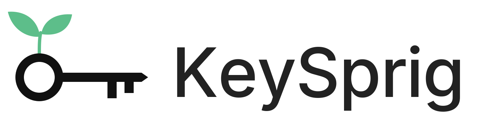

<p align="center"></p>

<p align="center"><strong>Your keys. Your agents. Your control.</strong></p>

KeySprig is an API key vault for AI agents. Agents make approved API requests through MCP; KeySprig attaches the credential server-side and returns the response. There is no tool that returns a raw key.

**Self-host for free under the MIT license, or use [KeySprig hosted](https://keysprig.xyz) to avoid running the infrastructure yourself.** The hosted app is currently an invitation-only beta; paid hosted plans are planned and checkout is not yet available. [Request a beta invitation](mailto:keysprig@agentmail.to?subject=KeySprig%20beta%20invitation%20request).

## What it does

- Encrypted key storage with isolated user accounts.
- Remote MCP with OAuth sign-in; no GitHub token required.
- One generic `call_api` proxy with exact HTTPS hosts, allowed methods, expiring grants and shared rate limits.
- Chat-started private key setup through `setup_key`; AgentMail is the first preset.
- Revocation, secret-free activity metadata, invitations and beta feedback.
- [Copyable agent instructions and downloadable skill](https://keysprig.xyz/connect).

## Quick start

Requires Node.js 24, a Supabase project and a Cloudflare account for deployment.

```sh
npm ci
cp .env.example .env.local
cp .dev.vars.example .dev.vars
```

Configure your own project credentials privately, apply the migrations in filename order, and complete [Supabase setup](docs/supabase-setup.md). Then:

```sh
npm run build
npm start
```

Open `http://127.0.0.1:3417`. For deployment, authenticate Wrangler with your own Cloudflare account and run `npm run deploy` after building. The default configuration uses your Workers preview address; add your own custom domain when ready. Replace hosted-product URLs, contact addresses and legal copy when operating your own instance.

## Connect an agent

Add your instance's `/mcp` URL to a client supporting remote MCP with OAuth. Sign in and approve the connection, even with no keys selected. Ask “Add my AgentMail API key”; the agent uses `setup_key` to provide a private entry link. Paste the key on that page and approve the agent's access. Use `call_api` for subsequent requests.

Not every chat client supports MCP or can configure connections automatically. The instructions require agents to state those limitations before claiming success. Read [chat setup](docs/chat-key-setup.md).

## Security boundaries

The server holds the encryption root and can decrypt keys for approved calls. This is **not zero-knowledge storage**. Approved destination APIs receive credentials. Response scrubbing covers known secret representations, not every possible transformation. Cloudflare Workers DNS prechecks are not socket-level IP pinning. Provider permissions and spending limits remain important. Read [outbound security](docs/outbound-security.md) and [security reporting](SECURITY.md).

This is beta software, not a security certification. Test with dummy or restricted credentials first.

## Development

```sh
npm run typecheck
npm test
npm run build
```

[Testing guide](docs/testing.md) · [Deployment checklist](docs/operations-readiness.md) · [Contributing](CONTRIBUTING.md)

## License

Source code is [MIT licensed](LICENSE). Third-party packages and the Google sign-in graphic retain their own terms; see [notices](THIRD_PARTY_NOTICES.md). The license does not grant trademark rights or imply affiliation with the hosted service.

Created by the [aislop.gr](https://aislop.gr) team and GPT.
